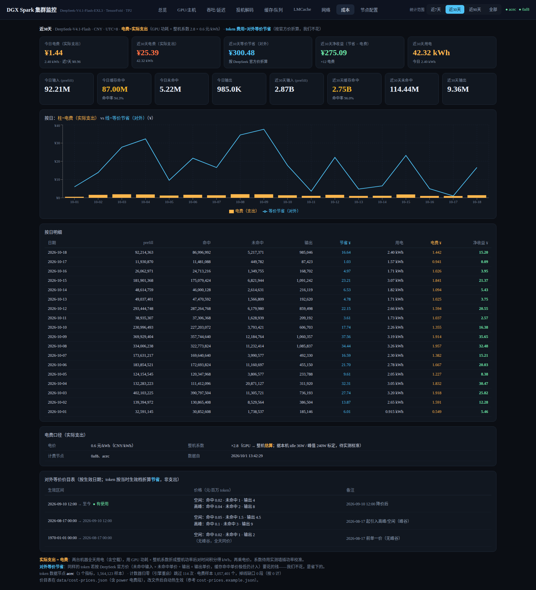

# DGX Spark 集群监控面板 · DeepSeek-V4.1-Flash / TensorFold 版

双 DGX Spark 跑 **DeepSeek-V4.1-Flash-EXL3（TensorFold 引擎，TP2，1M 上下文）** 的实时监控：**每台机器上跑一个 All-in-one 采集代理**（内嵌时序数据库 + systemd 服务），中控通过 **HTTP 拉取**（不是 SSH）汇聚两节点数据，React 面板绘图，并把 token 用量与电费折算成**成本页**。

> 📖 **新手从这里开始**：先看 [GUIDE.md](GUIDE.md)（手把手配置向导：环境检查 → 装 agent → 启动面板）。
> 🧷 **脱敏对照表**：[VARIABLES.md](VARIABLES.md)——本文档不含任何真实 IP/主机名，`.env` 里填你的真实值。
> ⚙️ **配置机制**：[CONFIG.md](CONFIG.md)——两层配置、生命周期、CRUD API。

## 🙏 致谢与来源

本项目基于 **[@maliubiao](https://github.com/maliubiao)** 的
[dgx-spark-2-deepseek-flash-dashboard](https://github.com/maliubiao/dgx-spark-2-deepseek-flash-dashboard)（MIT License）改造，
原项目面向"双 DGX Spark 跑 DeepSeek-Flash-0731"的监控，提供了整套 **Go agent + Node 中控 + React 面板**的三层架构与采集指标。
我们保留并沿用了这套骨架，在此之上适配 **TensorFold 引擎的 DeepSeek-V4.1-Flash**，并新增了成本核算与若干体验修复。

版权声明 `Copyright (c) 2026 maliubiao` 见 [LICENSE](LICENSE)（MIT），本仓库的改动同样以 MIT 发布。

## 架构

```
┌───────────────────── 节点 A (head, 172.x) ─────────────────────┐   ┌──────────── 中控 ────────────┐   ┌──────────────┐
│ TensorFold 引擎  :18891  /v1/chat/completions                  │   │  apps/server :8890           │   │ React 面板    │
│   · TP2 rank0/rank1（本机 + 节点 B）                            │◄──┤   puller 每 2s 增量拉取       │◄──┤ 总览/GPU/吞吐 │
│   · 1M 上下文 · MTP 投机解码 · prompt 缓存 + 落盘 spill          │   │   store.ts → SQLite 全量镜像  │   │ 投机/缓存/网络│
│ dspark-agent     :9100  /snapshot /range /changes               │   │   /api/nodes|snapshot|range   │   │ 成本/节点配置 │
│   · host.* 主机指标        · vllm.* 服务层指标                  │   │   /api/meta|cost              │   └──────────────┘
│   · 本地 SQLite TSDB（7 天保留）                                │   │   cost.ts 按历史价目+峰谷折算  │
└──────────────────────────────────────────────────────────────┘   └──────────────────────────────┘
                    ▲                                                    ▲
                    │ HTTP :9100（同样方式）                              │ data/cost-prices.json
┌───────────────────── 节点 B (worker) ─────────────────────┐             （改文件热生效）
│ TensorFold 引擎  :18891（TP2 rank1）                       │
│ dspark-agent     :9100（vLLM 节点跳过服务层采集）           │
└─────────────────────────────────────────────────────────────┘
```

- **Agent**（Go，单静态二进制 `.aarch64`）：本机采集 → 写本地 SQLite 时序库 → 暴露 `/snapshot /range /changes`。仅安装时用一次 SSH。
- **中控**（Node 24+ 或 Bun，零 runtime 依赖）：增量拉两台 agent 的 `/changes` 落本地库（间隔 `POLL_MS`，默认 **2000ms**），提供 `/api/*` + 托管前端。
- **面板**（React + Vite + Recharts）：总览 / GPU主机 / 吞吐延迟 / 投机解码 / 缓存队列 / LMCache / 网络 / **成本** / 节点配置。


## 本项目做了什么（相对上游）

### 1) 适配 TensorFold 的 DeepSeek-V4.1-Flash

| 项 | 上游（vLLM 0731） | 本项目（TensorFold） |
|---|---|---|
| 服务层指标源 | vLLM `/metrics` | TensorFold `/health` + `/v1/models`（经 agent 的 `vllm.*` 通道派生） |
| prefill 吞吐 | `prompt_tokens` 差分 | `prompt_tok_s` **排除 prefix 缓存命中**——命中 ~99% 时旧算法把缓存当 prefill，会虚高数万 tok/s |
| 投机解码 | `spec_pos_0..5_rate` 逐位置曲线 | TensorFold 不导出逐位置数据 → `SPEC_PER_POS=0` 改为文字说明 |
| 显存 | nvidia-smi 有值 | GB10 报 `[N/A]` → `--query-compute-apps` 逐进程求和 + `/proc/meminfo` 近似（统一内存） |
| 附加健康度 | — | `kept prompts`（prompt 缓存占用）、spill 落盘、队列/并发/抢占 |

### 2) 新增「成本」页

- **两个口径分列，不混为一谈**：电费 = 实际支出（GPU 功耗 × 整机系数 × 电价）；token = 对外等价节省（按 DeepSeek 官方价折算——钱我们不花，是省下来的）。
- **按历史价目分段折算**：`data/cost-prices.json` 按生效日期分段，token 按**当时生效价**计；峰谷分时电价单独计。改文件热生效。
- **按日明细 + 净收益**（节省 − 电费）；今日/近7天/所选范围/全期多口径并列，命中率、用电 kWh、计数器归零次数、掉线缺口段数都在脚注里透明展示。
- 计算规模：token 全表扫描约 **5000 万行**，60s 缓存兜底；电费按 GPU 功耗采样积分。

### 3) 范围控件统一（2026-10-18）

- 顶栏**唯一**一个范围控件：时序页 = 时间窗（15分 / 1小时 / 6小时 / 24小时 / 7天），成本页 = 统计范围（近7天 / 近30天 / 近90天 / 全部），**每个页签独立记忆**；「节点配置」页不显示。
- 修复口径断裂：此前成本页的范围只改图和表、**不改顶部统计卡**（实测差 4 倍）。现在所有卡片跟随所选范围，"今日/近7天"明确标注为固定口径对照。

### 4) 其它修复与增强

- `CLUSTER_NAME` / `SERVED_MODEL`：切换被监控集群时标题一眼可辨，不用重建前端。
- `POLL_MS` 默认 10s → **2s**，首页实时卡刷新更快。
- **采集健壮性**：落库/读取过滤 NaN/±Inf（曾因 `vllm.itl_avg_s` 算出 `+Inf` 让 `/changes` 返回空 body、中控拉取永久卡死）；连续失败 ≥3 次读 `last_write` **跳过异常窗口自愈**。
- 首页去掉与页头重复的节点状态卡；成本页补回「今日电费」「今日 token」统计。

## 配置机制（速览）

```
机器 (agent, /etc/dspark-agent.env):  采集什么/频率/保留期   ← 安装脚本写
         │
         ▼  HTTP :9100
Mac (中控 config_nodes 表):           拉取谁/地址/启停        ← 面板「节点配置」页 CRUD
```

- 节点配置**持久化**在 `data/central.db`；`.env` 仅在首次播种；改配置**不用重启**（≤ 拉取间隔生效）
- 完整机制与 API 见 [CONFIG.md](CONFIG.md)

## 集群标识与常用开关（`.env`）

中控启动时读取 `.env`（`--env-file-if-exists`），以下开关**改完重启中控即生效**，标题类**无需重建前端**：

| 变量 | 默认 | 作用 |
|---|---|---|
| `CLUSTER_NAME` | `DGX Spark 集群` | 面板标题 + 浏览器标签页显示的**集群名**（如 `DeepSeek-V4.1-Flash-EXL3 · TensorFold · TP2`），切换监控对象时一眼可辨 |
| `SERVED_MODEL` | 空 | 被服务模型名，随 `/api/meta` 下发 |
| `POLL_MS` | `2000` | 中控拉取各 agent 的间隔（ms，最小 500）；越小实时数字越新 |
| `SPEC_PER_POS` | `1` | 引擎是否导出"逐位置投机接受率"：GLM = `1`；**DeepSeek-V4.1 / TensorFold = `0`**（该图改为说明） |
| `COST_PRICES` | `./data/cost-prices.json` | 成本页价目表路径：按生效日期分段的 token 价 + 峰谷电价；**改文件热生效**，见 `data/cost-prices.example.json` |

前端头部与 `document.title` 取自 `/api/meta` 的 `cluster` 字段；`SPEC_PER_POS` 控制投机解码页的逐位置图。**切换集群只需改 `.env` 重启中控，不用重建前端。**

## 效果预览

**只放成本页一张实拍**（其余页面截图会带上机器名/实时数据，公开仓库不留；每页构成见 [PREVIEWS.md](PREVIEWS.md)）：



想要其余页面就在自己环境一键生成：

```bash
pnpm exec playwright install chromium          # 一次性
bash docs/screenshots/capture.sh               # 需要面板正跑在 127.0.0.1:8890
```

页面构成：

- **总览**：双节点在线状态、服务健康卡（解码吞吐 / prefill / KV cache / prefix 命中率 / 投机解码 / 运行队列 / 延迟分位）、GPU 利用率与吞吐实时曲线
- **GPU/主机**：双机 GPU 利用率/温度/功耗/时钟、CPU 负载、内存、磁盘、推理容器占用
- **吞吐/延迟**：decode/prefill tok/s，TTFT / ITL / 端到端 / 排队 的 p50/p90/p99
- **投机解码**：接受率、平均接受长度、draft/accepted 累计
- **缓存/队列**：prefix 命中率、KV cache 使用率、运行/等待/抢占
- **网络**：RoCE 链路数、4 个 fabric 口双向吞吐
- **成本**（本项目新增）：电费=实际支出、token=对外等价节省，按日明细与净收益，今日/近7天/所选范围多口径

## 快速开始

**0. 填变量**：打开 [VARIABLES.md](VARIABLES.md) 弄清占位符含义 → `cp .env.example .env` 并替换为你的真实值。

### 1) 构建并安装 agent（一次性 SSH）

```bash
bash deploy/build-agent.sh                                  # 交叉编译 linux/arm64
bash deploy/install-agent.sh <HOST_B>                       # worker
bash deploy/install-agent.sh <HOST_A> --vllm http://127.0.0.1:8888   # head 采 vLLM

# 卸载
ssh <HOST_A> sudo systemctl disable --now dspark-agent
```

安装后：`/usr/local/bin/dspark-agent`，`/etc/dspark-agent.env`，`/var/lib/dspark-agent/metrics.db`（默认保留 7 天）。

### 2) 启动中控 + 面板

```bash
pnpm install
pnpm --filter dashboard build        # 也可 pnpm dev 跑 Vite 热更新
bash scripts/start-dashboard.sh      # 读取 .env 首次播种 → http://127.0.0.1:8890
```

> **配置机制**：`.env` 只在首次启动时播种节点，之后在面板「节点配置」页增删改
> （配置中心，持久化到 SQLite，改完立即生效）。详见 [GUIDE.md](GUIDE.md) 第 5.1 节。

开发模式（热更新，Vite 代理 /api → 8890）：

```bash
pnpm dev:server     # 终端1
pnpm dev:dash       # 终端2 → http://127.0.0.1:5173
```

### 3) 环境自检（随时可跑）

```bash
bash scripts/preflight.sh     # HTTP 自检；加 SSHT=1 再查双机 SSH
```

## 指标清单

### 主机层（每台，默认 2s）
`host.gpu.util/.temp_c/.power_w/.sm_mhz/.present` · `host.cpu.util` · `host.load1/5/15` · `host.mem.used_pct/.used_gb` · `host.disk.used_pct` · `host.net.*.rx_bps/.tx_bps`（含 4 个 fabric 口）· `host.roce.active`（RoCE 链路数）· `host.container.cpu_pct/.mem_mb`（vLLM 容器）

### 服务层（head，默认 2s，采 vLLM /metrics）
- 吞吐：`vllm.decode_tok_s/.iter_tok_s`（增量速率）；`vllm.prompt_tok_s`（真实 prefill 计算吞吐，**排除 prefix 缓存命中**——命中~99% 时旧式 prompt_tokens 差分会把缓存命中误算成 prefill，已修正）
- 延迟分位：`vllm.ttft/itl/e2e/queue 的 _p50/_p90/_p99`（从直方图算）
- 投机解码：`vllm.spec_accept_rate/.spec_accept_len/.spec_pos_0..5_rate`
- 缓存：`vllm.prefix_hit_rate/.prompt_cached_pct`
- 并发：`vllm.running/.waiting/.preemptions`
- 累计：`vllm.gen_tok_total/.prompt_tok_total/.spec_*_total`

## 存储

- Agent：SQLite `series(name, ts, val)` PK(name,ts) WITHOUT ROWID + `latest` 快照缓存，WAL，7 天保留 + 每小时修剪。
- 中控：同构 `series(node, name, ts, val)`，全量历史镜像。库文件 `data/central.db`（已 gitignore）。

## API（agent `:9100` / 中控 `:8890`）

| 路由 | 说明 |
|---|---|
| `GET /health` | 存活、行数、最近写入 |
| `GET /snapshot` | 每个系列最新值 |
| `GET /series` | 系列清单 |
| `GET /range?name=&from=&to=&step=` | 区间（step>0 时 AVG 降采样） |
| `GET /changes?since=&limit=` | 增量（中控同步用） |

中控 `:8890`：`/api/nodes /api/health /api/snapshot /api/series /api/range /api/meta` + `/api/cost?days=7|30|90|365` + 前端静态文件。

## 目录

```
GUIDE.md      手把手配置向导（新手入口）
CONFIG.md     配置机制说明（两层配置/生命周期/CRUD API）
VARIABLES.md  占位符对照表（脱敏）
agent/        Go 采集代理（tsdb.go 时序库 · collect.go 采集 · vllm.go 派生产物 · main.go HTTP）
apps/server/  Node 中控（config.ts 配置库 · store.ts 镜像库 · puller.ts 动态拉取 · cost.ts 成本折算 · index.ts API）
apps/dashboard/ React 面板（含「成本」「节点配置」页）
data/         cost-prices.json 价目表（按生效日期分段，改后热生效；*.db 已 gitignore）
 deploy/      build-agent.sh 交叉编译 · install-agent.sh 装 systemd · dspark-agent.service
 scripts/     preflight.sh 环境自检 · start/stop-dashboard.sh
```

## 已知边界

# 显存占用（GB10 统一内存近似）：compute-apps 求和 / 系统 MemTotal
`host.gpu.mem_used_gb/.mem_total_gb/.mem_used_pct`（nvidia-smi 报 `[N/A]` 时自动回退，不再记 0）
- GB10 的 nvidia-smi 报 `[N/A]` 显存 → agent 用 `--query-compute-apps` 每进程求和得到 `host.gpu.mem_used_gb`，总量用 `/proc/meminfo` 系统内存近似（统一内存）；面板的“显存占用”卡/曲线即此值（DSpark 下 vLLM 自身 `kv_usage_pct` 基本失效，不用它）。
- 每台 agent 在无 vLLM 节点上跳过服务层采集。
- **采集健壮性**：agent 落库与读取均**过滤 NaN/±Inf**——非有限值会让 `/changes` 的 JSON 编码失败、返回空 body，进而使中控拉取永久卡死（2026-10-10 曾因 `vllm.itl_avg_s` 算出 `+Inf` 触发）；`/changes` 编码异常时也返回合法 JSON 而非空 body；中控对某节点连续拉取失败 ≥3 次会读其 `/health` 的 `last_write` **跳过异常窗口自愈**，最近一次错误见 `/api/nodes` 的 `err` 字段。
- 中控与面板需要与集群同 LAN。

## 一键打理

```bash
bash scripts/start-dashboard.sh           # 中控+面板（后台）
bash scripts/stop-dashboard.sh            # 停止
```
